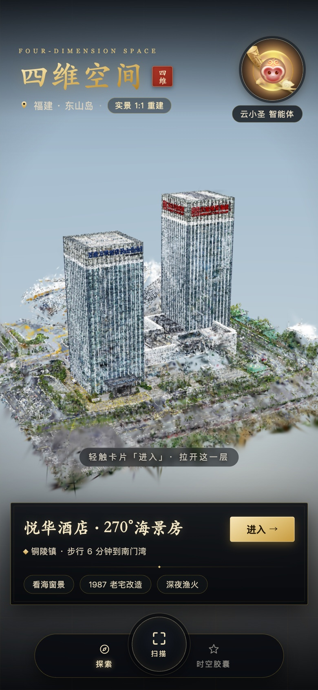
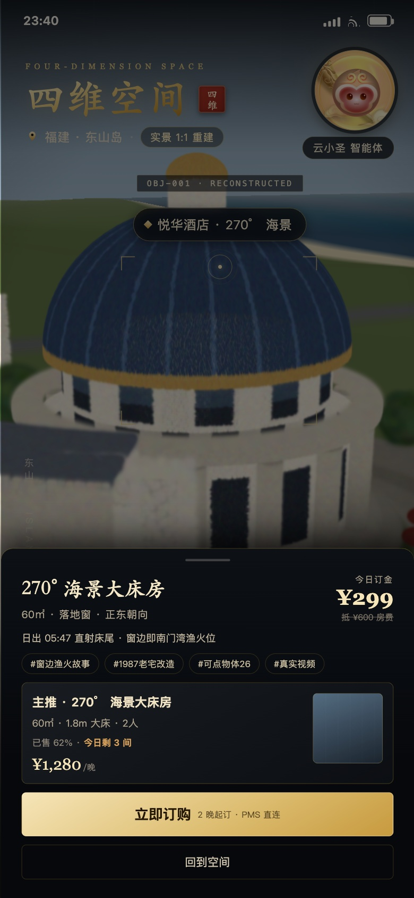

# 四维空间 · 实景空间探索器

面向东山岛悦华酒店的移动端「真实空间」入口。**核心是一套自研的 3DGS（3D Gaussian Splatting）+ 倾斜摄影 3D Tiles 移动渲染引擎**，一份代码同时跑在 iOS / Android App 与微信小程序里。

<p>
  
  
</p>

- 首页 HUD、地标卡、底部导航、进入过渡、房型浮层，按《原型图 V2.0 · 墨金东方版》还原
- Luma 式入场：点云从粉尘态按随机相位凝聚成实体，同时相机缓推；交互带时间常数阻尼、惯性、空闲自转、双击复位
- 3DGS 场景：21.6 万 splat / 9 个空间分块 / 2 级 LOD，流式加载、后台排序、跨块 LOD 交叉淡入
- 倾斜摄影：3D Tiles（tileset.json + glb/b3dm），屏幕空间误差驱动 LOD、显存 LRU 淘汰
- 零运行时依赖（没有 three.js、没有 Cesium），生产包 **57 KB JS + 16 KB CSS**，全部图形逻辑自己实现

---

## 快速开始

```bash
npm install          # 只装 vite + typescript（开发依赖）
npm run assets       # 生成演示资产（程序化 3DGS 点云 + 倾斜摄影瓦片）
npm run dev          # http://localhost:5178
npm run build        # 产出 dist/
npm run serve        # 以 dist/ 起静态服务，手机访问 http://<局域网IP>:5178
```

调试参数：

| 参数 | 作用 |
| --- | --- |
| `?shot=1` | 跳过开场运镜，直接落在成片机位（截图/自动化用） |
| `?hud=0` | 隐藏 UI，只看 3D |
| `?debug=1` | 右下角显示 FPS / splat 数 / draw call / 显存 / 画质档位 |
| `?ply=…` | **直接加载你自己的 .ply / .splat**（本地或远程） |
| `?tiles=…` | **直接加载 3D Tiles 倾斜摄影** |
| `?fit=1` | 加载完自动取景 |
| `?intro=0` | 关闭入场动画（相机推进 + 点云凝聚） |
| `?spin=0` | 关闭空闲自转 |

交互与动效设计见 [`docs/INTERACTION-DRAWER.md`](docs/INTERACTION-DRAWER.md)（“抽屉式”空间进入：状态机 / 时间轴 / 镜头语言 / 资产分层）。

用真实模型联调的完整说明见 [`docs/DEBUG.md`](docs/DEBUG.md)：

```bash
# 只调点云
http://localhost:5178/?ply=assets/local/hotel.ply&fit=1&debug=1
# 点云 + 倾斜摄影一起
http://localhost:5178/?ply=assets/local/hotel.ply&tiles=/__proxy/https/xxx/tileset.json&fit=1
```

---

## 目录结构

```
src/
  main.ts                  应用编排：加载、过渡、HUD、交互
  app.css                  墨金东方视觉系统（885×1920 设计稿等比缩放）
  engine/
    Engine.ts              WebGL2 上下文、渲染循环、自适应画质、上下文丢失恢复
    Camera.ts / OrbitControls.ts   轨道相机与移动端手势（惯性、双指缩放、轻点命中）
    SplatRenderer.ts       3DGS 绘制核心：纹理实例化、协方差投影、分块排序、LOD 淡入
    SplatLoader.ts         3DGS 资产加载（Worker 解析 + 切块，失败自动回退主线程）
    splatFormat.ts         .splat / .ply(INRIA) 解析与空间切块
    radix.ts               16bit 两趟计数排序（LSD radix）
    shaders.ts             全部 GLSL ES 3.00 着色器
    Tiles3D.ts             3D Tiles 遍历 / LOD / 内容加载 / 显存预算
    gltf.ts                glTF / GLB 最小读取器（网格、顶点色、贴图、节点变换）
    PerfGovernor.ts        帧时间驱动的画质分档
  engine/workers/          sort.worker.ts / splat.worker.ts
tools/gen-scene.mjs        演示资产生成器（程序化酒店点云 + 地形瓦片）
platforms/weapp/           微信小程序壳（web-view 承载同一份 H5）
platforms/capacitor/       App 壳接入说明
capacitor.config.ts        iOS / Android 打包配置
```

---

## 引擎架构

```
                 ┌──────────────── Engine（60fps 主循环）────────────────┐
                 │  PerfGovernor ── 渲染分辨率 / splat 预算 / 误差阈值     │
                 │        │                                              │
  manifest.json ─┼─▶ 资产调度                                             │
                 │    ├─ SplatLoader ──Worker──▶ 解析 .ply/.splat ─▶ 切块  │
                 │    └─ Tiles3D ──fetch──▶ glTF/b3dm ─▶ VAO + 纹理      │
                 │                        │                              │
                 │  SplatRenderer ◀───────┘                              │
                 │   纹理实例化 → 协方差投影 → 由远及近 alpha 混合          │
                 └──────────────────────────────────────────────────────┘
```

### 1. 3DGS 渲染：纹理实例化，避免每帧上传顶点

每个 splat 的位置 / 尺度 / 四元数 / 颜色 / 不透明度被压进 4 张纹理（RGBA32F ×3 + RGBA8 ×1），排序结果放进 1 张 R32UI 纹理。绘制时只发一次 `drawArraysInstanced`，顶点着色器用 `gl_InstanceID` 去索引纹理——**相机怎么动都不需要重传顶点数据**，只有排序索引（4 字节/点）会更新。

顶点着色器完成 3DGS 的标准投影：`Σ = R·S·Sᵀ·Rᵀ` → `J·W·Σ·Wᵀ·Jᵀ` → 二次型 conic；片元用 `exp(-½·dᵀΣ⁻¹d)` 算高斯衰减，预乘 alpha 后 `ONE / ONE_MINUS_SRC_ALPHA` 混合。

### 2. 排序：16bit 两趟计数排序，放 Worker 里做

3DGS 必须由远及近混合。20 万点的排序如果放主线程用 `Array.sort` 会直接掉帧，所以：

- 深度量化到 16bit，两趟 8bit 计数排序（LSD radix），O(n)、无比较、无 GC；
- 排序在 `sort.worker` 里跑，主线程只负责把结果 `texSubImage2D` 到索引纹理；
- 每帧最多调度 2~3 个分块，按屏幕占比排序，相机静止时零排序；
- Worker 不可用（老 WebView / CSP）时自动降级为主线程时间片排序。

实测：单块 1~3ms，整场 9 块在拖动过程中 4~5 帧内追平。

### 3. 分块 + 双 LOD + 交叉淡入

splat 按 XZ 空间切成 9 块，每块 0.4~1.1 万点。每块有独立包围球、独立排序队列、独立显存：

- **视锥剔除**：包围球对 6 个平面做测试，块级剔除后 GPU 只画可见块；
- **LOD**：低模先到先显示，高模到达后直接顶上，低模淡出并释放显存，不闪不跳；
- **预算控制**：可见点数超过预算时用 `uIdxStride` 抽样（每 k 个取 1），排序顺序不变，画面只是变糙不会错乱。

### 4. 倾斜摄影：屏幕空间误差驱动

`Tiles3D` 是 3D Tiles 的最小可用实现：解析 `tileset.json`、节点变换、包围盒/球，按 `SSE = geometricError × 屏高 / (2·d·tan(fov/2))` 递归选瓦片，`REPLACE` 父子互斥、`ADD` 叠加；内容支持 `.glb/.gltf/.b3dm/.i3dm`（自动剥头、读 `RTC_CENTER`）；显存超预算按最久未使用淘汰。

### 5. 自适应画质：掉帧优先降精度，不降交互

`PerfGovernor` 只认帧时间（EMA）：>26ms 降一档，<13.5ms 稳定 240 帧后升一档，带 1.4s / 2.6s 冷却，避免抖动。档位同时调整渲染分辨率（0.55×~1.0×DPR）、splat 预算（7万~42万）、倾斜摄影误差阈值、每帧排序数。

### 6. 不闪退的几道保险

| 风险 | 处理 |
| --- | --- |
| 设备不支持 WebGL2 | 首帧前探测，直接切静态海报 + 房型浮层，交易链路可用 |
| 显卡上下文丢失（后台切换/驱动重置） | 监听 `webglcontextlost`，阻止默认行为 → 恢复后重建 program/纹理/瓦片，并重放已加载数据 |
| 单个资产 404 / 解析失败 | 该块跳过，其余照常渲染，Toast 提示，不阻塞主流程 |
| Worker 创建失败 | 自动回退主线程解析与排序 |
| 显存涨爆 | splat 常驻上限 + 倾斜摄影 220MB LRU 淘汰 |
| 首帧卡死 | 加载器有超时与并发上限，页面隐藏时暂停渲染 |
| 异常冒泡 | 渲染循环 try/catch，出错停帧但不白屏，UI 与订购入口仍在 |

---

## 替换成真实资产

演示资产是程序生成的（`npm run assets`），格式与真实管线一致，直接替换文件即可。

### 本机真实模型（models/）

`models/` 目录里的模型**不会被打进 dist / 小程序包**，只在 `npm run dev` / `npm run serve` 时由本机提供：

```bash
npm run lod -- 你的.ply --out models/我的场景 --chunk 120000 --lod 0.08 --keep 0.5
```

打开 `http://localhost:5178/` 会**默认加载** `models/HS_Bolimuqiang/manifest.json`（存在时），
不存在则回落到演示场景；`?scene=demo` 强制回演示。

Z-up 的扫描件（大部分手机/无人机重建都是）在 manifest 里写 `"transform": { "rotateX": -90 }` 即可立起来。

### 资产预处理：大 PLY → 分块 + 两级 LOD

原始 PLY 一次性塞进显存是移动端卡顿的根因。先离线切一刀：

```bash
npm run lod -- 你的模型.ply --out public/assets/local/hotel --chunk 150000 --lod 0.15
```

输出 `manifest.json` + `splat/lod0|c1/*.splat`，直接开：

```
http://localhost:5178/?manifest=assets/local/hotel/manifest.json&fit=1&debug=1
```

实测（1.83M 点 / 118MB PLY）：处理 2s、峰值内存 493MB，产出 27 块 × 2 级，
LOD0 8.4MB（首屏只要这些）、LOD1 55.7MB；浏览器里 60fps、27 draw call、显存 98MB。

### 3DGS

先看 [`docs/DEBUG.md`](docs/DEBUG.md)：用 `?ply=` 参数可以直接加载单文件模型，不用改代码。

支持两种输入：

1. **分块 + 多 LOD（推荐）**：`manifest.json` 的 `splat.tiles` 列表，每项 `{ url, lod, key, min, max }`，同一 `key` 的不同 `lod` 会合并成一个分块并做交叉淡入。
2. **单文件**：`splat.source` 指向一个 `.ply` / `.splat`，引擎在 Worker 里按空间自动切块。

格式要求：

- `.ply`：INRIA 3DGS 原生导出（`f_dc_0..2` / `opacity` / `scale_0..2` / `rot_0..3`，二进制小端）
- `.splat`：32 字节/点（pos 3f + scale 3f + rgba 4B + quat 4B），`scale` 是**米**，`quat` 用 `v*128+128` 编码
- 坐标系：Y 轴向上、单位米、原点在场景中心（与倾斜摄影共用一套坐标）
- 建议单块 ≤ 6 万点，LOD0 ≈ 精细层点数的 15~20%，整场精细层 ≤ 30 万点（移动端显存约 16MB）

### 倾斜摄影

标准 3D Tiles 1.0 `tileset.json`，`refine: REPLACE`，`geometricError` 按层级递减（如 240 / 70 / 18），内容为 `.glb` 或 `.b3dm`。OSGB 用 Cesium ion 或 `3dtiles` 工具链转成 3D Tiles 后直接指向即可。

### 场景清单

```jsonc
{
  "scene": { "name": "四维空间", "location": "福建 · 东山岛", "tags": [] },
  "camera": { "target": [0,4,10], "distance": 93, "yaw": 0.12, "pitch": 0.7, "fov": 55,
              "introFrom": { "distance": 220, "pitch": 1.02, "yawOffset": 0.5 } },
  "splat":  { "tiles": [ { "url": "splat/lod1/t00_l1.splat", "lod": 1, "key": "t00",
                           "min": [-44,-2,-44], "max": [-14.7,34,-14.7] } ] },
  "tileset": "tiles/tileset.json",
  "hotspots": [ { "id": "hotel", "label": "悦华酒店 · 270° 海景", "position": [0,26.5,0] } ]
}
```

---

## 平台打包

### App（iOS / Android）

见 [`platforms/capacitor/README.md`](platforms/capacitor/README.md)：装 Capacitor → `npx cap add ios/android` → `npm run build && npx cap sync`。

### 微信小程序

见 [`platforms/weapp/README.md`](platforms/weapp/README.md)：小程序用 `<web-view>` 承载同一份 H5 产物。

> **为什么小程序不直接渲染**：小程序 `<canvas type="webgl">` 只有 WebGL 1.0，缺 GLSL ES 3.00、浮点纹理、整数纹理，而 3DGS 的协方差投影与索引排序强依赖这三项；且小程序不允许自定义上下文恢复，闪退不可控。走云渲染则是另一套架构。

---

## 已验证

在 390×844 / DPR 2 的移动视口（Chrome 156 + SwiftShader 软件渲染，比真机 GPU 更苛刻）下：

- 21.6 万 splat + 10 块倾斜摄影瓦片，稳定 60fps / 16.7ms，draw call 16~19
- 显存占用 12MB（splat 7.7MB + 瓦片缓存）
- 首帧加载 7.7MB 资产 < 1.5s（本地），LOD0 先出图再逐块精修
- 上下文丢失 / Worker 失败 / WebGL2 缺失 / 资产 404 四条降级路径均实测可恢复

## 已知限制

- 演示场景是程序化几何生成的「仿 3DGS」点云，用于验证引擎；换成真实重建资产后质感会有数量级提升（真实资产带烘焙光照与更密采样）。
- 3DGS 排序是分块内的全局排序 + 块间按距离排序，块边界极近重叠时理论上有混合误差；生产上按 30~50m 分块可忽略。
- 倾斜摄影为保通用性关闭了背面剔除，几何量大的城市级瓦片建议在导出时保证朝向一致。
- 未包含室内 3DGS 场景与真实 POI 命中（点击选中单体化物体），当前以 3D 锚点热点 + 房型浮层替代。
